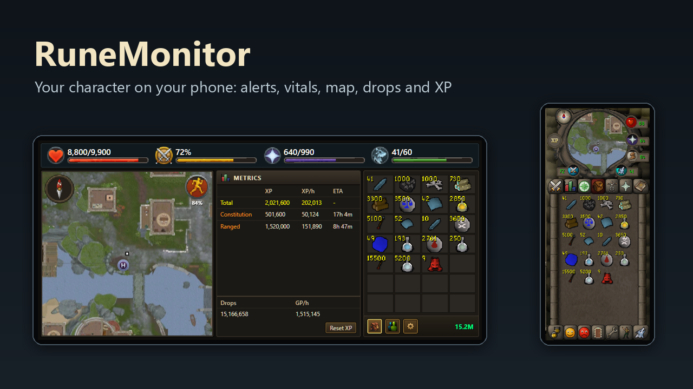
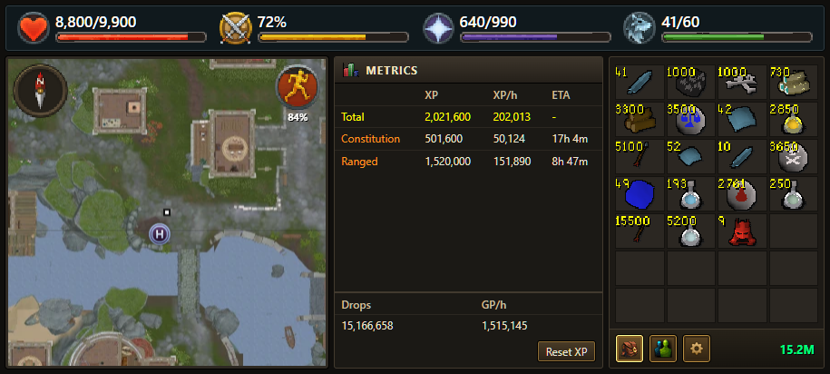
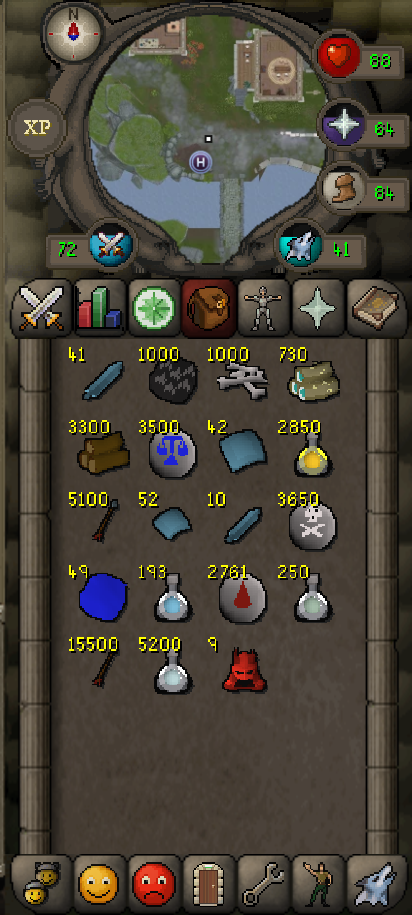
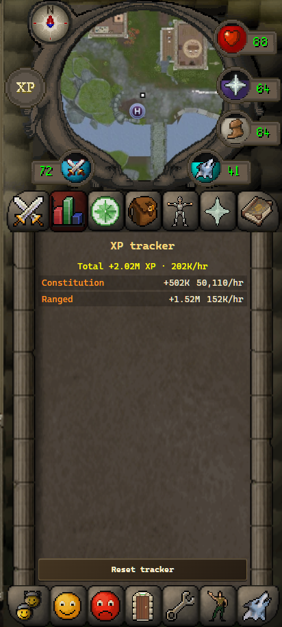
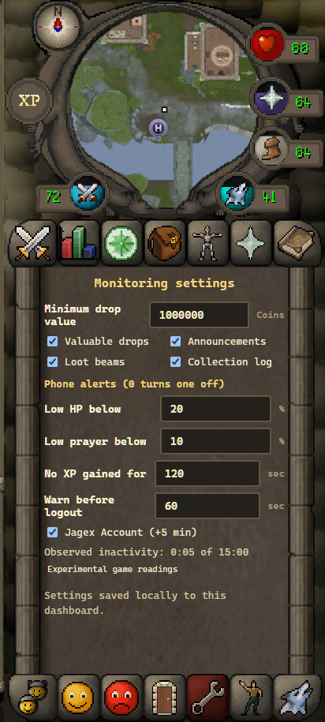
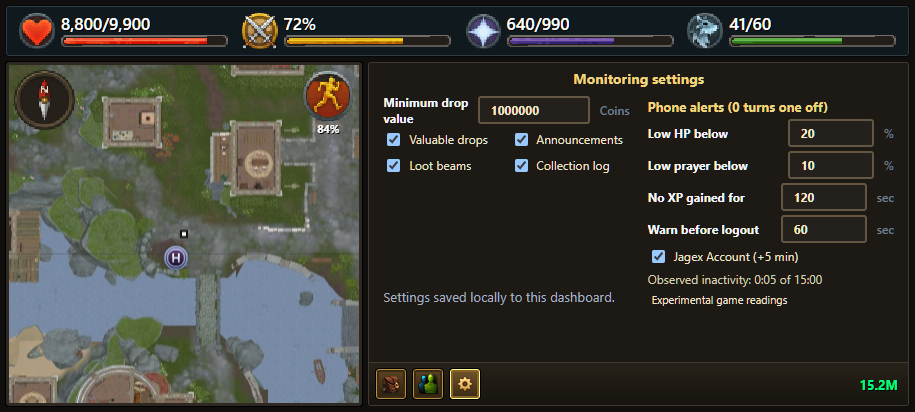

# RuneMonitor setup guide

RuneMonitor puts your RuneScape character on your phone. You get alerts for
low HP or prayer, the idle logout, loot beams, collection log entries and
valuable drops, plus a live view of your vitals, map, backpack drops and XP.

It has three parts, all free:

1. **The RuneMonitor plugin**, from the in-game Plugin Hub.
2. **RuneMonitor Relay**, a small program on your PC. The plugin hands your
   character's status to it, and your phone reads it from there.
3. **The RuneMonitor app** for Android, or the web page on any phone.

Everything stays on your PC and phone. Nothing is sent to the plugin's
developer. See [What RuneMonitor sends where](#what-runemonitor-sends-where).

## What you need

- A Windows PC that runs RuneScape.
- A phone on the **same Wi-Fi** as that PC.
- For alerts while your phone is locked: an Android phone (Android 8 or newer).
  iPhones can use the live view in Safari, but only get alerts while that page
  is open.

## 1. Install the plugin

1. In RuneScape, open the **Plugin Hub** and install **RuneMonitor**. The Hub
   also installs **PrettyUI**, which RuneMonitor needs.
2. When the game asks about RuneMonitor's permissions:
   - Allow **HTTP access**. RuneMonitor only uses it to talk to the relay on
     your own PC (`127.0.0.1`).
   - **Chat access** is optional. Allow it for loot beam, collection log and
     game announcement alerts. RuneMonitor only reads game messages about you;
     it never reads or sends player chat.

## 2. Run the relay on your PC

1. Download **RuneMonitor-Relay.exe** from the
   [releases page](../../releases/latest) and put it somewhere you'll find it
   again, for example your Documents folder.
2. Double-click it.
   - Windows may say **"Windows protected your PC"** because the program isn't
     from a big publisher. Click **More info**, then **Run anyway**.
   - Windows Firewall may ask whether to allow it. Tick **Private networks**
     only, then **Allow**. This lets your phone reach it over your home Wi-Fi.
3. A RuneMonitor window opens with **"RuneMonitor is running."** and your
   phone's address. **Keep this window open while you play.** You can
   minimise it. If it says **"RuneMonitor is already running"**, another copy
   is already open on your taskbar; press Enter to close the extra one.
4. Optional: the window shows **Start with Windows: OFF**. To have RuneMonitor
   open by itself (minimised) when you sign in to Windows, type `S` and press
   **Enter**. Do the same again to turn it off.

## 3. Install the app on your phone (Android)

1. On your phone, download **RuneMonitor-1.0.1.apk** from the
   [releases page](../../releases/latest) and open it.
2. Android asks you to allow installs from your browser or Files app. Allow it
   for that app only, then tap **Install**.
3. Play Protect may warn that it doesn't know the app. Choose **Install anyway**.

## 4. Link your phone

1. In RuneScape, open RuneMonitor (its icon in the ribbon, or the cog next to it
   in the Plugin Hub) and choose **Link phone**. A QR code appears. It's valid
   for 2 minutes; choose **Link phone** again for a new one.
2. Open the RuneMonitor app and tap **Scan QR code**. Allow the camera when asked
   and point it at the QR code.
3. Tap **Pair character**.
4. Allow notifications when Android asks.

**iPhone:** scan the QR code with the normal Camera app, open the link in
Safari and tap **Pair character**. Keep the page open for alerts.

**More characters:** in the app, open the Characters panel (the door icon in
portrait, or the people icon in landscape) and tap
**Add a character (scan QR)**.

## 5. For reliable alerts (Android)

Many phones close background apps to save battery. Open **Settings → Apps →
RuneMonitor → Battery** and choose **Unrestricted**. Some phones (Samsung,
Xiaomi, OnePlus and others) also have a "sleeping apps" or "auto-launch" list;
make sure RuneMonitor isn't in it.

## Using it

Sideways, you get a RuneScape 3 style view: vitals, map, XP per hour and time to
level, drop value and GP per hour, and your recent drops.

Upright, you get an Old School style view. The tabs switch between your drops
(the backpack) and the XP tracker.

The backpack has 28 slots, one per item. When an item drops again it adds onto
that item's stack, so a long trip stays readable. When a 29th kind of item
drops, the item that has gone longest without dropping makes room. These
screenshots show 1,000 King Black Dragon kills at the game's drop rates.

| Drops | XP tracker | Settings |
|---|---|---|
|  |  |  |

- Turn your phone sideways for the RuneScape 3 style view, or hold it upright
  for the Old School style view.
- The wrench (portrait) or cog (landscape) opens **Settings**. Sideways, it
  opens in two columns:

  

  - **Minimum drop value**, plus on/off switches for valuable drops,
    announcements, loot beams and the collection log.
  - **Phone alerts:** low HP below a %, low prayer below a %, no XP gained for a
    number of seconds, and how long before the idle logout to warn you. Set a
    number to 0 to turn that alert off.
  - **Jagex Account:** leave this ticked if you log in with a Jagex Account. It
    adds 5 minutes to your idle logout timer, and members get another 5, so most
    members have 15 minutes.
- The app keeps the screen on while it's open, and works in portrait and
  landscape.
- **Loot beams** show a chip at the top of the screen with a pie that empties
  over the item's 3 minutes on the ground: green while only you can see it
  (the first minute), yellow once other players can, and red in the last
  minute before it disappears. Tap it to hide it. On Android
  the notification counts down too and disappears when the item does. The
  timer can't tell when you pick the item up.
- Tap any item in the backpack to see its name, quantity and value. This is
  handy for noted items, which all look like the same note.

## Stop or remove RuneMonitor

You can pause or remove each part on its own.

| To… | Do this |
|---|---|
| Pause phone alerts | Tap **Stop** on the RuneMonitor notification. Opening the app starts them again. |
| Stop the relay on your PC | Close the RuneMonitor window. |
| Stop the relay starting with Windows | In the RuneMonitor window, type `S` and press **Enter** until it says **OFF**. Or press **Windows + R**, type `shell:startup`, press **Enter**, and delete **RuneMonitor Relay.cmd**. |
| Turn the plugin off in game | Open the **Plugin Hub → Manage** and disable or uninstall **RuneMonitor**. |
| Unlink a phone | In the app's Characters panel, tap **Unpair character**, or **Log out of dashboard** to unlink every character from that phone. |

**Remove everything:**

1. Uninstall **RuneMonitor** in the in-game Plugin Hub.
2. On your phone, long-press the RuneMonitor app and choose **Uninstall**.
3. If you turned on "start with Windows", turn it off first (see above).
4. Close the RuneMonitor window and delete **RuneMonitor-Relay.exe**.
5. Delete the relay's data folder: press **Windows + R**, type
   `%LOCALAPPDATA%\RuneMonitor`, press **Enter**, then go up one folder and
   delete the **RuneMonitor** folder. It holds your character links and
   settings.

## Something isn't working

- **"Can't reach the relay" on the phone:** check the RuneMonitor window is open
  on your PC, and that your phone is on the same Wi-Fi rather than mobile data.
  If your PC's address changed (for example after a router restart), choose
  **Link phone** in game again and scan the new QR code from the app's error
  screen.
- **No notifications:** check notifications are allowed for RuneMonitor and the
  battery setting above. Tapping **Stop** on the notification pauses alerts
  until you open the app again.
- **The QR code doesn't pair:** codes last 2 minutes. Choose **Link phone** again.
- **No loot beam or collection log alerts:** allow the plugin's Chat access, and
  check those switches are on in Settings.
- **The map is blank:** the map needs a moment after you move to a new area. Some
  instances have no map image.

## What RuneMonitor sends where

- **The plugin → the relay on your PC (`127.0.0.1`):** your character's display
  name, HP, prayer, adrenaline, run energy, familiar spell points, skill XP,
  position in the game world, whether you're on a members world, how long since
  your last key press or mouse movement, items that dropped for you, and game
  messages that name you (announcements, loot beams, collection log). Nothing
  about other players is sent.
- **The relay → your phone:** the same information, only to phones you paired by
  scanning a QR code, over your home Wi-Fi.
- **The relay → the internet:** to show item pictures and prices it asks
  RuneScape's official item database by item number. To draw the map it
  downloads map pictures of the area you're in from RuneApps (runeapps.org).
  These requests contain no name or account details.
- **Stored on your PC:** your character links, the phones you paired and your
  settings, in `%LOCALAPPDATA%\RuneMonitor`. Live readings, drops, the XP tracker
  and alerts are kept in memory only and are gone when the relay closes.
- **Stored on your phone:** the relay's address, your pairing and which alerts
  you've already seen.
- Nothing is sent to the plugin's developer.

RuneMonitor only reads what the game shows you. It never presses keys, clicks,
or plays the game for you.
